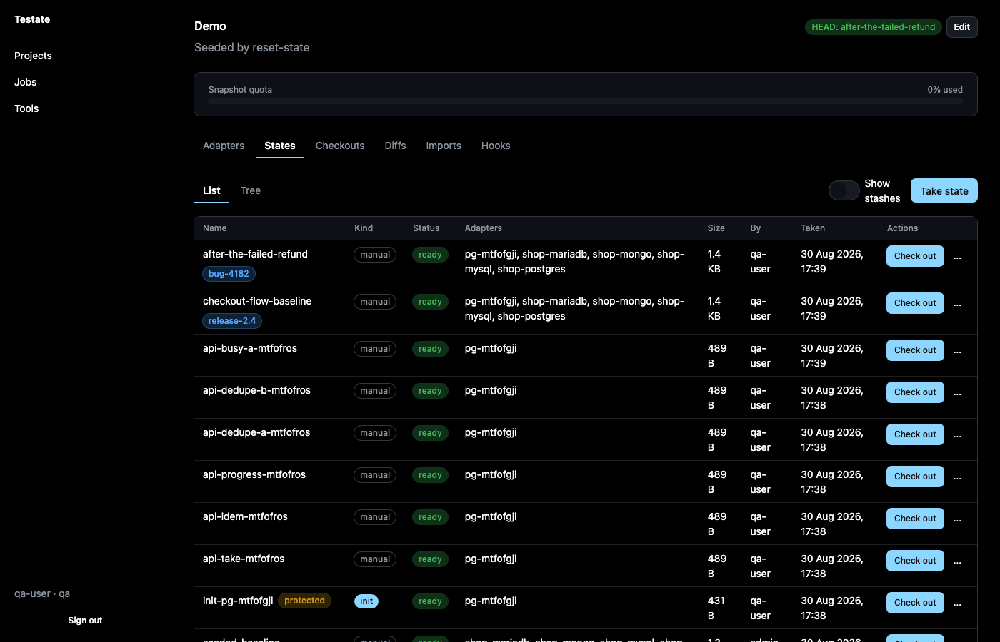

<div align="center">


[](https://github.com/PT-Perkasa-Pilar-Utama/testate/actions/workflows/ci.yml)
[](https://scorecard.dev/viewer/?uri=github.com/PT-Perkasa-Pilar-Utama/testate)
[](https://github.com/PT-Perkasa-Pilar-Utama/testate/releases)
[](LICENSE)

**[Try the demo](https://pt-perkasa-pilar-utama.github.io/testate/demo/)** &nbsp;·&nbsp;
**[Install](#install)** &nbsp;·&nbsp;
**[Docs](#docs)** &nbsp;·&nbsp;
**[Website](https://pt-perkasa-pilar-utama.github.io/testate/)**

</div>

Take a snapshot of your test databases. Break them. Put them back in seconds.

Testate runs beside the system under test and talks to its databases directly. Nothing is added
to your application. One binary, one data directory, no account, no telemetry.

- **Take a state:** a data-only snapshot of every database in a project.
- **Check it out:** put every database back with one click or one API call.
- **Diff:** compare two states, or a state and the live data, down to the cell.

The [demo](https://pt-perkasa-pilar-utama.github.io/testate/demo/) runs the real app in your
browser on sample data. Nothing leaves the tab.



## Install

Linux and macOS:

```sh
curl -fsSL https://pt-perkasa-pilar-utama.github.io/testate/install.sh | sh
testate setup             # data directory, port, sealing key, first admin
testate service install   # starts it now and at every boot
```

Open <http://localhost:7378>, sign in as `admin`, and change the password when asked. Back up `~/.config/testate/testate.env`:
it holds the key that reads your stored credentials.

Or run the container:

```sh
openssl rand -base64 32 > testate.key   # keep it: every upgrade needs the same key
docker run -d --name testate -p 7378:7378 -v testate-data:/data \
  -e TESTATE_SECRETS_ACTIVE_KEY="$(cat testate.key)" \
  -e TESTATE_ADMIN_PASSWORD=change-me-now-1234 \
  ghcr.io/pt-perkasa-pilar-utama/testate:2.0.0
```

Windows and download checks: [Install](docs/INSTALL.md). From 1.x: [Upgrade](docs/MIGRATING.md).
Before you add the first database, read [Connecting a database](docs/CONNECTING.md): the host is
the one setting that catches people.

## Reset a database from CI

```sh
curl -sf -X POST "$TESTATE_URL/api/v1/projects/shop/checkouts?wait=120" \
  -H "Authorization: Bearer $TESTATE_TOKEN" -H "Content-Type: application/json" \
  -d '{"state_name": "seeded-baseline"}' | jq -r '.data.job.status'
```

Gate the step on `status`, not the HTTP code. AI agents connect over MCP with a token scoped to one project:
[Agent access](docs/AGENT_ACCESS.md).

## Supported engines

| Tier     | Engines                                                        | What you get                            |
| -------- | -------------------------------------------------------------- | --------------------------------------- |
| Tabular  | PostgreSQL, MySQL, MariaDB                                     | snapshot, check out, diff, edit, import |
| Document | MongoDB                                                        | snapshot, check out, diff               |
| Files    | S3-compatible storage, SFTP, FTP                               | browse, upload, rename, delete          |
| Logs     | Log files, pushed lines, journald, Docker, Loki, Elasticsearch | read, filter, follow, masked            |

Every SFTP host and database server also gets graphs under **Monitor**: CPU, memory, disk,
network and each pm2 app, sampled every 30 seconds. Nothing is installed on the host.

Testate resets only the databases you add, one at a time. Read [the limits](docs/LIMITS.md)
before you install it.

## Docs

| Run it                                     | Use it                                                    | Reference                                         |
| ------------------------------------------ | --------------------------------------------------------- | ------------------------------------------------- |
| [Install](docs/INSTALL.md)                 | [Connecting a database](docs/CONNECTING.md)               | [Changelog](CHANGELOG.md)                         |
| [Upgrade from 1.x](docs/MIGRATING.md)      | [Tester guide](docs/user-guide/tester-guide-en/README.md) | [API specs](docs/api-specs/_index.md)             |
| [Deployment plan](docs/DEPLOYMENT_PLAN.md) | [CI/CD](docs/CI_CD.md)                                    | [Technical specs](docs/technical-specs/_index.md) |
| [Key rotation](docs/KEY_ROTATION.md)       | [Agent access](docs/AGENT_ACCESS.md)                      | [Security](SECURITY.md)                           |

## Contributing

```sh
bun install
cp apps/api/.env.example apps/api/.env   # set the key and the admin password
bun run dev                              # API on :7378, dashboard on :7379
```

[CLAUDE.md](CLAUDE.md) lists every command and rule.

## License

MIT. Copyright PT. Perkasa Pilar Utama.
