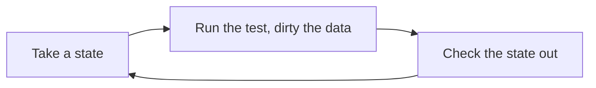

<div align="center">


[](https://github.com/PT-Perkasa-Pilar-Utama/testate/actions/workflows/ci.yml)
[](https://scorecard.dev/viewer/?uri=github.com/PT-Perkasa-Pilar-Utama/testate)
[](https://github.com/PT-Perkasa-Pilar-Utama/testate/actions/workflows/codeql.yml)
[](https://github.com/PT-Perkasa-Pilar-Utama/testate/releases)
[](LICENSE)

**[Introduction](#introduction) &nbsp;&nbsp;&bull;&nbsp;&nbsp;**
**[Getting started](#getting-started) &nbsp;&nbsp;&bull;&nbsp;&nbsp;**
**[Docs](#docs) &nbsp;&nbsp;&bull;&nbsp;&nbsp;**
**[Website](https://pt-perkasa-pilar-utama.github.io/testate/) &nbsp;&nbsp;&bull;&nbsp;&nbsp;**
**[License](#license)**

</div>

## Introduction

**Git for your test database.** Snapshot it, break it, put it back in seconds.

Testate runs beside the system under test, takes data-only snapshots of its databases, and puts any of them back on demand. One binary or one container, one data directory, no account, no telemetry. Version 1.2.0.

Every QA team knows this chat:

> "Could you wipe the transactions on UAT? I can't create another order."

So a developer stops and resets the database by hand, or writes a reset endpoint that must never ship. QA does not automate, because every run needs a clean database first. Nobody lets an AI agent near a shared database, because one hallucinated `DELETE` is one too many.



- **Take a state.** A data-only snapshot of every database in a project, at one moment, with a name and tags.
- **Break it.** Run the suite, click through the app, edit rows in the grid, load a fixture.
- **Check it out.** One click or one API call puts every database back and reports per database. A stash is taken first, so even that is reversible.
- **See what moved.** Diff two states, or a state against the live database, down to the changed cell.

Nothing gets added to your application. Testate is a separate service that talks to the databases directly.

**[Try it in your browser](https://pt-perkasa-pilar-utama.github.io/testate/demo/)**: the real app on sample data, running in the page. Nothing leaves the tab.


## Getting started

### Install and start Testate

Linux (x86-64, ARM64) and macOS (Apple silicon, Intel):

```sh
curl -fsSL https://pt-perkasa-pilar-utama.github.io/testate/install.sh | sh
testate setup                  # data directory, port, sealing key, first admin
testate service install        # keeps it running and starts it at boot
```

`testate setup` writes the sealing key to `~/.config/testate/testate.env`. Back that file up: without the key, the stored database credentials cannot be read. Windows, the other ways to run it, and how to verify a download: [Install](docs/INSTALL.md).

### Or run the container

```sh
openssl rand -base64 32 > testate.key     # keep this file; every upgrade needs the same key
docker run -d --name testate -p 7378:7378 -v testate-data:/data \
  -e TESTATE_SECRETS_ACTIVE_KEY="$(cat testate.key)" \
  -e TESTATE_ADMIN_PASSWORD=change-me-now-1234 \
  ghcr.io/pt-perkasa-pilar-utama/testate:1.2.0
```

The same image is on Docker Hub as `snowfluke/testate`. Compose, a reverse proxy and upgrades: [Deployment plan](docs/DEPLOYMENT_PLAN.md).

### Use the dashboard

Open <http://localhost:7378>, sign in as `admin`, and change the password when asked. Add a database under **Databases**, take a state under **States**, break something, click **Check out**.

Where to point the host is the one thing that catches people. Read [Connecting a database](docs/CONNECTING.md) before you add the first one.

### Use the API

Every screen sits on the REST API, and the instance serves its own reference at `/api/v1/docs`. A pipeline resets a database with one call before a run:

```sh
curl -sf -X POST "$TESTATE_URL/api/v1/projects/shop/checkouts?wait=120" \
  -H "Authorization: Bearer $TESTATE_TOKEN" -H "Content-Type: application/json" \
  -d '{"state_name": "seeded-baseline"}' | jq -r '.data.job.status'
```

Gate the step on the job's `status`, not the HTTP code. Tokens and idempotency: [CI/CD](docs/CI_CD.md).

### Let an agent look

Testate speaks MCP. An admin creates an **agent** token scoped to a project; it reaches `/api/v1/mcp` and nothing else.

```sh
claude mcp add --transport http testate https://testate.example.internal/api/v1/mcp \
  --header "Authorization: Bearer tst_YOUR_TOKEN"
```

Reads run in a read-only transaction, column policies mask values before the agent sees them, and every call is audited. Roles, tools and expiry: [Agent access](docs/AGENT_ACCESS.md).

## What it works with

| Tier     | Engines                                                                                              | What you get                                           |
| -------- | ---------------------------------------------------------------------------------------------------- | ------------------------------------------------------ |
| Tabular  | PostgreSQL, MySQL, MariaDB                                                                           | view, snapshot, checkout, diff, extract, edit, import  |
| Document | MongoDB                                                                                              | view, snapshot, checkout, diff, extract                |
| Files    | Object storage (any S3-compatible), SFTP, FTP                                                        | view, preview, download, insert, rename, delete, batch |
| Logs     | Log files, lines your app pushes, systemd journal, Docker, Grafana Loki, Elasticsearch or OpenSearch | read, filter, follow, download, masked for viewers     |

Every engine here is real and driven over its own protocol. The database tiers also get a **Server logs** tab. S3-compatible means Amazon, Cloudflare R2, Google Cloud Storage, Backblaze B2, MinIO and anything else that speaks the protocol.

Also in the box: a data grid with filters, keyset paging and write mode; a read-only SQL console with saved queries; CSV and XLSX import with a dry run; fixture extraction as SQL or JSON; resource readings of the hosts and database servers, two at a time side by side; three roles (Administrator, Tester, Guest); an audit log of every write.

Testate resets databases one at a time, and only the ones you add. Read [the limits](docs/LIMITS.md) before you install it.

## Docs

[Install](docs/INSTALL.md) · [Connecting a database](docs/CONNECTING.md) · [Deployment plan](docs/DEPLOYMENT_PLAN.md) · [Limits](docs/LIMITS.md) · [CI/CD](docs/CI_CD.md) · [Agent access](docs/AGENT_ACCESS.md) · [Key rotation](docs/KEY_ROTATION.md) · [Tester guide](docs/user-guide/tester-guide-en/README.md) · [Changelog](CHANGELOG.md) · [PRD](docs/PRD.md) · [Technical specs](docs/technical-specs/_index.md) · [API specs](docs/api-specs/_index.md) · [Security standards](docs/SECURITY_STANDARDS.md) · [Security](SECURITY.md)

## Contributing

```sh
bun install
cp apps/api/.env.example apps/api/.env      # set the key and the admin password
bun run dev                                 # API on :7378, dashboard on :7379
```

`bun run reset:dev --yes --engines`, then `bun run seed:dev`, then `bun run dev`: a clean dev instance holding the demo project the test suite uses, on the databases from `deploy/compose.engines.yml`. [CLAUDE.md](CLAUDE.md) has the rest of the commands and the rules.

## License

MIT. Copyright PT. Perkasa Pilar Utama.
