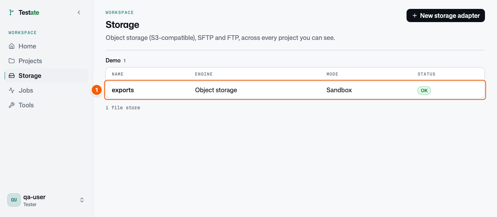
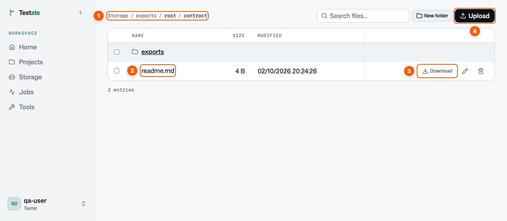
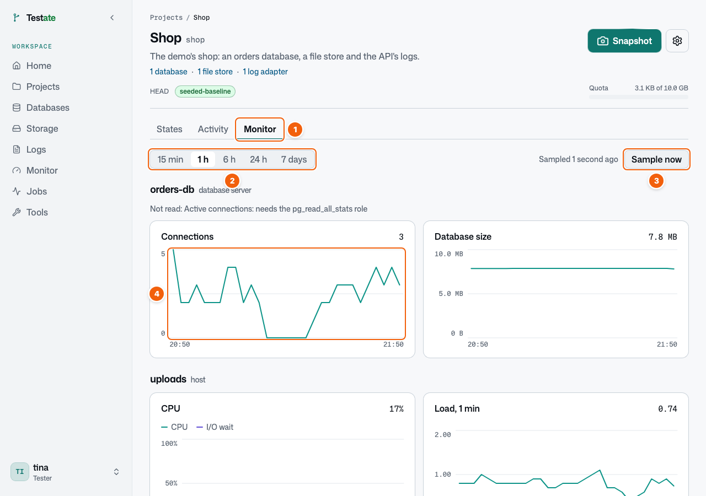
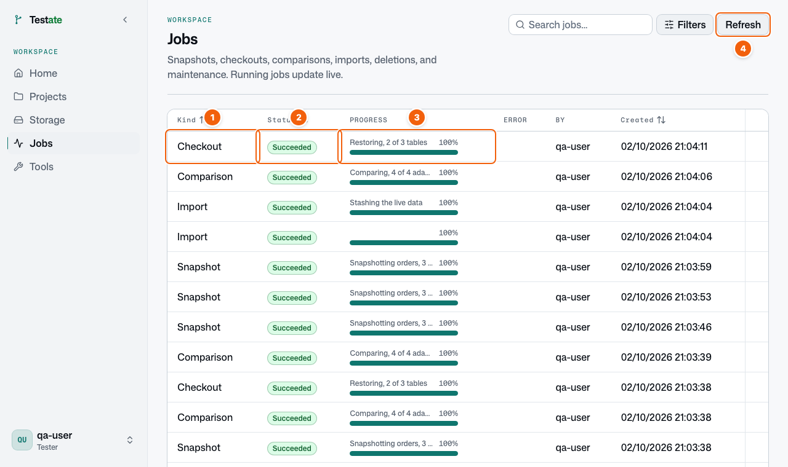

# File, Jobs, dan Tools

## File

Sebagian proyek terhubung ke penyimpanan file, misalnya S3, SFTP, atau FTP. Klik **Storage** di menu samping.

| No. | Apa ini | Yang Anda lakukan |
| --- | --- | --- |
| 1 | Penyimpanan file | Klik untuk membuka file-nya. |

| No. | Apa ini | Yang Anda lakukan |
| --- | --- | --- |
| 1 | Lokasi | Posisi Anda sekarang. Klik bagian lokasi untuk naik kembali. |
| 2 | File | Klik untuk melihat pratinjau. Klik folder untuk membukanya. |
| 3 | **Download** | Simpan file ke komputer Anda. |
| 4 | **Upload** | Unggah file ke folder ini. **New folder** membuat folder baru. Hanya bisa di penyimpanan Sandbox. |

Penyimpanan file tidak pernah masuk ke state. Checkout tidak mengubah file Anda.

## Monitor

Testate membaca server di balik proyek setiap 30 detik: server database, dan mesin yang menyimpan file dan aplikasi. Hasilnya ditampilkan sebagai grafik. Gunakan grafik ini saat tes gagal dan Anda ingin tahu apakah penyebabnya mesin, misalnya disk penuh, CPU sibuk, atau aplikasi yang restart.

Buka proyek, lalu klik tab **Monitor**.

<!-- 30-monitor.png diambil dari demo di browser: server SFTP di dev stack tidak punya file host untuk digrafikkan. scripts/guide-screens.ts tidak membuatnya. -->

| No. | Apa ini | Yang Anda lakukan |
| --- | --- | --- |
| 1 | **Monitor** | Grafik server proyek ini. |
| 2 | Rentang waktu | Pilih seberapa jauh ke belakang: 15 menit sampai 7 hari. |
| 3 | **Sample now** | Baca server sekali lagi, sekarang. Testate juga membacanya sendiri. |
| 4 | Grafik | Arahkan kursor untuk melihat nilai pada waktu itu. |

Grafik terputus di saat Testate tidak bisa membaca server. Baris di bawah nama server menyebutkan apa yang tidak terbaca, dan alasannya. **Monitor** di menu samping menampilkan semua server di semua proyek Anda, dengan nilai terbaru.

## Jobs dan Tools

### Jobs

Snapshot, checkout, perbandingan, dan impor berjalan di latar belakang. Klik **Jobs** di menu samping untuk melihatnya.

| No. | Apa ini | Yang Anda lakukan |
| --- | --- | --- |
| 1 | **Kind** (jenis) | Jenis pekerjaan, misalnya **Checkout** atau **Snapshot**. |
| 2 | **Status** | **Succeeded** (berhasil), **Running** (berjalan), atau **Failed** (gagal). |
| 3 | **Progress** (kemajuan) | Seberapa jauh pekerjaan berjalan. Kolom **Error** menjelaskan alasan pekerjaan gagal. |
| 4 | **Refresh** | Muat ulang daftar. Pekerjaan yang berjalan diperbarui sendiri. |

### Tools

Menu **Tools** berisi tiga alat bantu kecil. **Hash** membuat hash dari sebuah nilai, misalnya password bcrypt untuk pengguna uji. **Random bytes** membuat nilai acak. **UUID v7** membuat ID baru. Testate tidak menyimpan apa pun yang Anda ketik di sini.

---

← Sebelumnya: [Membandingkan dua titik waktu](06-compare.md) · [Daftar isi](README.md) · Berikutnya: [Menyiapkan proyek baru](08-new-project.md) →
